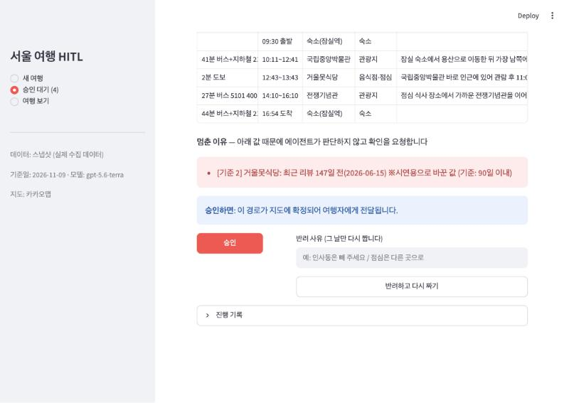

# 서울 여행 계획 HITL 에이전트

여행 날짜·가고 싶은 곳·숙소를 넣으면 에이전트가 날짜별 동선을 짠다. **확실히 틀린 부분은 스스로 고치고, 정보가 불확실한 날만 멈춰서 사람(여행자)에게 승인을 받는다.** 기준에 걸리지 않은 날은 사람을 거치지 않고 자동으로 확정된다.

아이펠 「에이전트 팀 꾸리기_Agt2」 5. 프로젝트 — 사람이 승인하는 에이전트 만들기. 설계와 결과는 [REPORT.md](REPORT.md)에 있다.



## 구성

- **LangGraph** 그래프 2개: 여행 그래프(후보 찾기 → 날짜별 배분) + 하루 그래프(동선 → 검사·자동 수정 → 자동 확정 또는 `interrupt`로 멈춤 → 승인/반려 후 재개)
- **SQLite 체크포인터**: 멈춘 날은 파일에 저장되어 앱을 다시 켜도 멈춘 지점부터 이어진다
- **승인 기준 4개**(계산 가능): 대안 없는 구간·막차 이후 / 음식점 영업 상태·최근 리뷰·영업시간 정보 / 관광지 운영 정보·특별 운영일 / 정보 마지막 확인일
- **Streamlit** 데모 + **카카오맵** 지도(키가 없으면 OpenStreetMap)
- LLM: OpenAI `gpt-5.6-terra` (실습과 같은 제공사). 응답은 `cache/llm/`에 캐시해 같은 입력이면 다시 부르지 않는다

## 설치

Python 3.14에서 개발·확인했다(다른 버전은 확인하지 않았다).

```bash
uv venv .venv && uv pip install --python .venv/bin/python -r requirements.txt
```
uv가 없으면 `python3 -m venv .venv && .venv/bin/pip install -r requirements.txt`.

## 키 설정

```bash
cp .env.example .env
```
`.env`를 열어 값을 넣는다. `.env`는 `.gitignore`에 들어 있어 저장소에 올라가지 않는다.

| 키 | 필요한 때 | 없으면 |
|---|---|---|
| `OPENAI_API_KEY` | 새 여행의 동선을 짤 때 | 캐시에 있는 입력(시나리오 4건)만 실행된다 |
| `KAKAO_JS_KEY` | 카카오맵 표시 | OpenStreetMap으로 대체 |
| `KAKAO_REST_KEY` | 데이터를 다시 수집할 때 | 저장된 스냅샷으로 실행 |
| `GOOGLE_PLACES_KEY` | 쓰지 않음 | — |

카카오 키: [카카오디벨로퍼스](https://developers.kakao.com/console/app) → 앱 생성 → **[카카오맵] > [사용 설정] 상태 ON** → **[앱] > [플랫폼 키]**에서 JavaScript 키·REST API 키 확인 → JavaScript 키의 **JavaScript SDK 도메인**에 `http://localhost:8501` 등록. 무료 한도는 계정당 처음 카카오맵을 켠 앱에만 주어진다. 비즈월렛을 연결하지 않으면 한도를 넘어도 과금되지 않는다(429 오류).

## 실행

```bash
.venv/bin/streamlit run app.py
```
http://localhost:8501 → **새 여행**에서 동선 만들기 → **승인 대기**에서 상세 확인 후 승인 또는 반려(사유 입력) → **여행 보기**에서 날짜별 지도.

저장한 데이터(`data/snapshot/`)로 바로 실행된다. 스냅샷이 없으면 `tests/fixtures/`의 시험용 데이터를 쓴다.

```bash
.venv/bin/python -m pytest                     # 테스트 74개
.venv/bin/python scripts/run_scenarios.py      # REPORT의 시나리오 4건 재실행 → results/results.md
```
시나리오는 LLM 캐시로 돌아서 키 없이도 같은 결과가 나온다.

## 데이터

서울 장소 41곳(관광지 20·음식점 18·숙소 3), 구간 320개. 2026-11-09에 카카오 장소 검색·대중교통 경로 API와 카카오맵 장소 페이지로 모았다.

> ⚠ 승인 기준을 시연하려고 **일부 값을 일부러 바꿨다**(예: 잘빠진메밀 서촌점 "폐업", 거울못식당 최근 후기 6월). 실제 가게·장소의 사실이 아니며, 화면에는 "※시연용으로 바꾼 값"으로 표시된다. 목록과 출처는 [data/README.md](data/README.md).

다시 수집하려면:
```bash
.venv/bin/python scripts/collect.py places
.venv/bin/python scripts/collect.py segments
.venv/bin/python scripts/collect.py build
```

## 폴더

```
app.py                  Streamlit 데모
config.py               모델명, 기준값(90일·30일), 수정 상한(3회), 기준일
trip/
  models.py             장소·구간 모델 (정보 없음 None ↔ 휴무 [] 구분)
  provider.py           데이터 계층 (스냅샷 + 시연용 덮어쓰기, 없는 구간은 추정)
  schedule.py           시각 계산
  rules.py              승인 기준 1~4 + 확실한 오류 검사
  fixer.py              자동 수정(음식점 교체·순서 변경·날짜 이동)과 판정
  planner.py prompts.py LLM 동선 짜기 + 응답 캐시
  graphs.py             LangGraph 여행·하루 그래프 (interrupt)
  service.py            체크포인터, 여행 시작·대기 목록·재개
  maps.py               카카오맵 / OpenStreetMap
  live_kakao.py         카카오 API 호출
data/                   스냅샷, 시연용 덮어쓰기, 수동 확인 정보
scenarios/ results/     REPORT용 고정 입력과 실행 결과
scripts/                수집, 시나리오 실행
tests/                  테스트와 시험용 데이터
docs/superpowers/       설계 문서, 구현 계획
```
