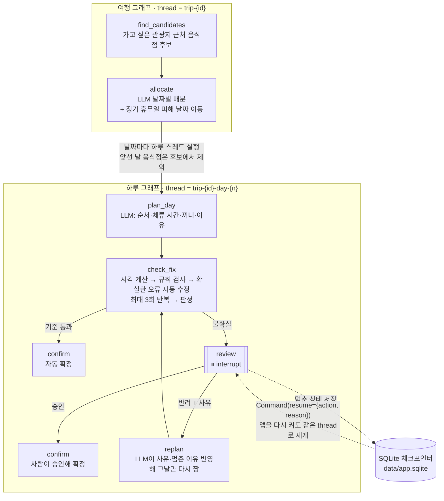
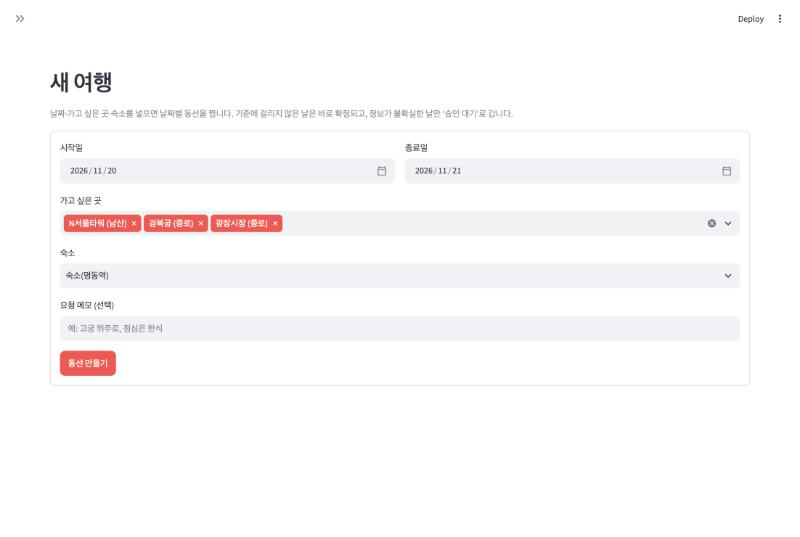
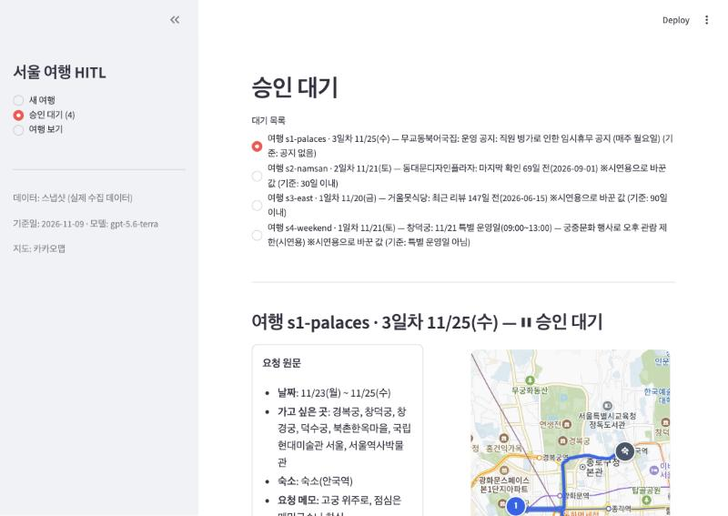
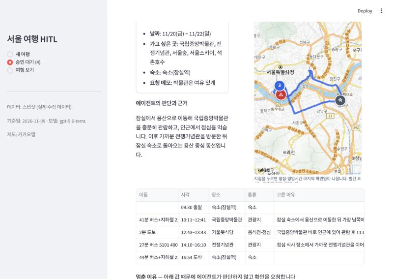
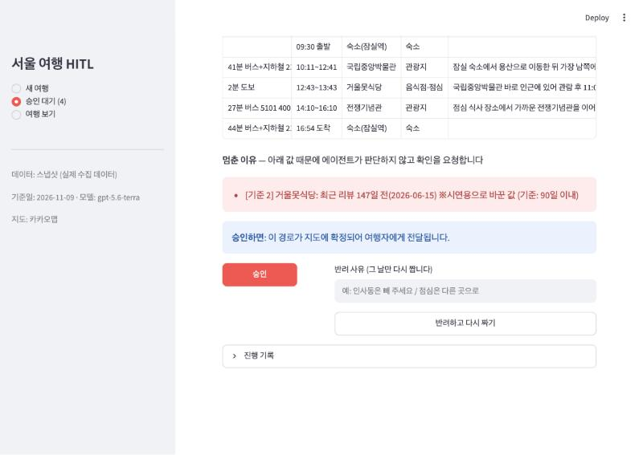
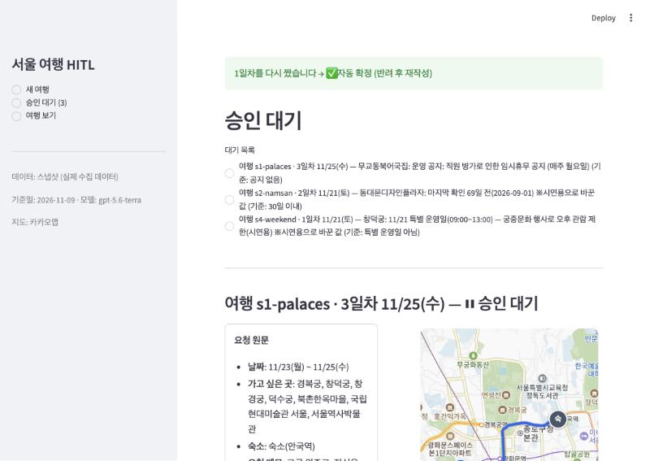
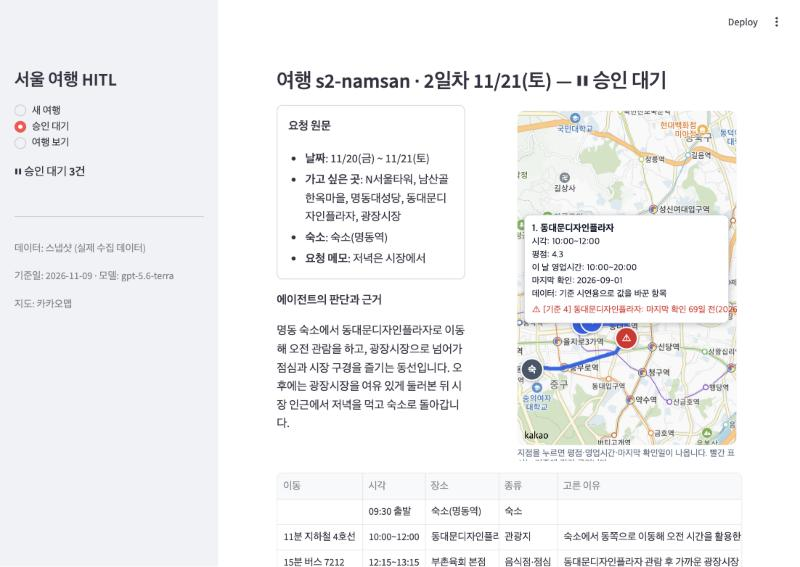
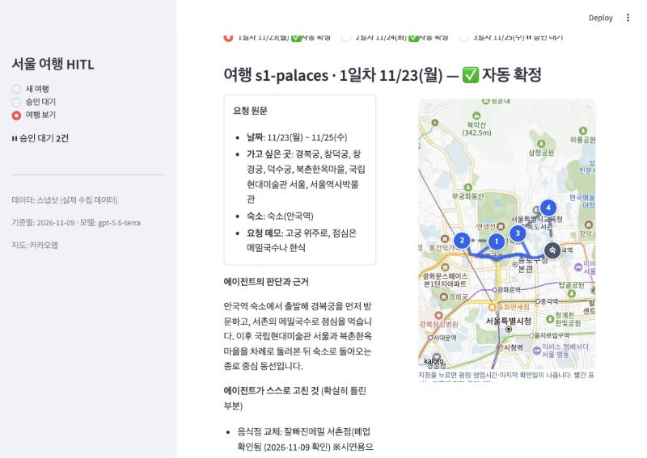

# REPORT — 서울 여행 계획 HITL 에이전트

아이펠 「에이전트 팀 꾸리기_Agt2」 5. 프로젝트 — 사람이 승인하는 에이전트 만들기
작성일 2026-11-09 · 설계 문서 [docs/superpowers/specs](docs/superpowers/specs/2026-11-09-seoul-trip-hitl-design.md) · 구현 계획 [docs/superpowers/plans](docs/superpowers/plans/2026-11-09-seoul-trip-hitl-plan.md)

---

## 1. 주제와 고른 이유

**주제:** 여행 날짜·가고 싶은 곳·숙소를 넣으면 날짜별 동선을 짜 주는 서울 여행 에이전트.

최종 목표는 지도 위에 경로가 그려지고, 여행자가 그 지도를 보며 실제로 움직이는 여행 앱이다. 이번 과제에서는 그 앱의 핵심 엔진인 **"계획을 짜고 → 검사하고 → 불확실한 날만 사람이 확인하는" 파이프라인**을 만들었다.

고른 이유는 실제로 겪은 위험 세 가지다.
1. 추천 코스대로 갔는데 그 지역으로 가는 버스가 없어졌다.
2. 음식점에 갔더니 문이 닫혀 있거나 없어졌다.
3. 운영시간이 자주 바뀌는 관광지는 시간을 고려해 동선을 짜야 한다.

세 가지 모두 **"에이전트가 가진 정보가 지금 현실과 맞지 않을 위험"**이다. LLM이 아무리 그럴듯한 동선을 짜도 이 위험은 없어지지 않는다. 그래서 사람이 확인할 자리가 분명히 필요하다.

### 결과가 바깥으로 나가는 단계

**계획이 지도에 확정되어 여행자에게 넘어가는 순간.** 여행자는 확정된 계획을 믿고 그대로 움직인다. 그래서 이 순간이 잘못된 정보가 현실의 피해(헛걸음, 이동 수단 없음)로 이어지는 지점이다. 승인하는 사람은 여행자 본인이고, 멈추는 단위는 **하루**다. 문제없는 날은 바로 확정하고, 문제 있는 날만 확인을 받는다.

---

## 2. 파이프라인 구조

### 2.1 전체 흐름

### 2.2 노드가 하는 일과 State 흐름

`DayState`의 주요 필드가 노드마다 어떻게 바뀌는지 정리했다. 값은 모두 JSON으로 체크포인터에 저장된다.

| 노드 | 읽는 값 | 쓰는 값 |
|---|---|---|
| `plan_day` | date, lodging_id, attraction_ids, restaurant_ids, request.note | plan(장소 순서·체류 시간·끼니·이유), summary, status=planning |
| `check_fix` | plan | plan(자동 수정 반영), schedule(계산된 시각표), issues, **verdict**(auto_confirm / needs_review + 이유 목록), actions(누적), history(누적), status=waiting 또는 planning |
| `review` | verdict | `interrupt(멈춘 이유, 승인하면 일어나는 일)`로 멈춤. 재개되면 human_decision, history |
| `replan` | plan, verdict.reasons, human_decision.reason | plan, summary, reject_count+1, human_decision=None |
| `confirm` | human_decision | status=confirmed, confirmed_by=auto 또는 human |

- **LLM은 순서·체류 시간·끼니·이유만 정한다.** 도착·출발 시각은 코드가 숙소 출발(09:30) + 구간 이동 시간 + 체류 시간으로 계산한다(`schedule.py`). 그래서 검사가 정확하고 실행할 때마다 같다.
- **멈추는 지점은 `review` 노드 하나다.** 재개 경로는 승인이면 `confirm`, 반려면 `replan → check_fix`(다시 검사)다.
- 하루를 스레드 하나로 둔 이유: 대기 목록의 한 줄이 곧 멈춘 스레드 하나가 된다. 또 2일차를 반려해도 3일차에는 영향이 없다.

### 2.3 두 종류의 문제를 나눈다

| 검사 결과 | 종류 | 처리 |
|---|---|---|
| 정기 휴무일 방문 (정보가 최근 확인됨) | 확실히 틀림 | 여행 단위: 그 장소가 여는 다른 날로 이동. 하루 단위: 순서 바꾸기 |
| 방문 시각이 영업시간 밖 | 확실히 틀림 | 순서 바꾸기, 음식점이면 다른 음식점으로 교체 |
| 음식점 폐업 확인 | 확실히 틀림 | 같은 끼니 자리에 근처의 영업 중인 음식점으로 교체 |
| 수집하지 않은 먼 구간(추정값) | 확실히 틀림 | 수집된 구간을 쓰도록 순서 바꾸기 |
| 승인 기준 1~4에 걸림 | 불확실 | 멈춤 |
| 확실히 틀렸지만 고칠 방법이 없음 / 수정 3회 초과 | 불확실 | 멈춤("자동 수정 실패") |

관광지는 일정에서 빼지 않는다. 여행자가 가고 싶다고 한 곳이기 때문이다. 뺄지 말지는 사람이 반려 사유로 정한다.

---

## 3. 승인 기준과 이유

모두 데이터에서 **계산**할 수 있는 조건이다(`trip/rules.py`). 숫자는 `config.py`에 있다.

| # | 대비하는 위험 | 멈추는 기준 | 이유 |
|---|---|---|---|
| 1 | 버스가 없어지거나 바뀜 | 추천 경로가 대중교통인데 **이동 방법이 하나뿐**이거나, 출발 예정 시각이 **추천 경로 막차 이후** | 대안이 있으면 노선 하나가 없어져도 여행자가 갈 수 있다. 대안이 없는 구간만 사람이 확인하면 된다 |
| 2 | 음식점 폐업·휴무 | 상태가 **영업 중이 아님**, 운영 **공지**가 있음, **최근 리뷰가 90일 넘게 없음**, **그 날짜 영업시간 정보가 없음** | 폐업한 가게는 상태가 늦게 바뀌는 경우가 많다. 리뷰가 끊긴 것이 가장 이른 신호다 |
| 3 | 관광지 운영시간 변동 | 방문 날짜의 **운영 정보가 없음**, **특별 운영일**, **임시 휴관·공지** | 특별 운영일에는 평소 시간표가 맞지 않는다. 정보가 없으면 에이전트가 판단할 근거가 없다 |
| 4 | 낡은 정보 전반 | 장소나 구간의 **마지막 확인일이 30일 초과** | 위 1~3의 판단 자체가 오래된 정보에 기댄 것일 수 있다 |

멈춘 이유는 **어느 기준의 어떤 값에 걸렸는지**를 문장으로 보여 준다.
`[기준 2] 거울못식당: 최근 리뷰 147일 전(2026-06-15) ※시연용으로 바꾼 값 (기준: 90일 이내)`

### 일부러 멈추지 않게 한 것

- **도보 구간**: 걷는 길은 노선처럼 없어지지 않는다. 그래서 기준 1·4를 검사하지 않는다.
- **막차 시각을 모르는 구간**: 카카오 경로 API는 막차를 주지 않는다. 모르면 멈추게 하면 거의 모든 날이 멈춘다(설계의 실패 조건). 그래서 막차를 아는 구간만 검사한다.

### 자동으로 확정되는 날을 사람이 보지 않아도 되는 이유

그 날의 모든 장소가 영업 중으로 확인됐고, 방문 시각이 영업시간 안이며, 모든 대중교통 구간에 대안이 있고, 모든 정보를 30일 안에 확인했기 때문이다. 이 중 하나라도 어긋나면 그 날은 멈춘다.

**자동으로 처리된 예 (s1 1일차, 11/23 월):** LLM이 점심으로 잘빠진메밀 서촌점을 골랐다. 이 가게는 시연용으로 "폐업"으로 바꿔 둔 곳이다. 에이전트는 사람에게 묻지 않고 같은 점심 자리에 토속촌삼계탕을 넣었다. 검사를 다시 통과해 그대로 자동 확정됐다.

---

## 4. 데이터

- 장소 41곳(관광지 20·음식점 18·숙소 3), 구간 320개, 2026-11-09 수집. 기준일(`REFERENCE_DATE`)도 이 날짜로 고정했다.
- 좌표·주소는 **카카오 장소 검색 API**, 구간은 **카카오 대중교통 경로 API**(255회 호출)로 모았다.
- 영업 상태·요일별 영업시간·휴무·공지·별점·최근 후기 날짜는 **카카오맵 장소 페이지를 하나씩 열어 옮겨 적었다**. 구글 Places는 결제 카드 등록이 필요해 쓰지 않았다.
- 실제 데이터에서 저절로 나온 사례가 있다. 고궁 정기 휴무일, 종묘 평일 시간제 관람(운영 정보 없음), 무교동북어국집 임시휴무 공지.
- **시연용 덮어쓰기 7개.** 실제 데이터만으로는 기준 1(대안 없음·막차), 특별 운영일, 오래된 정보, 폐업 사례가 생기지 않아서 값을 일부러 바꿨다. 바꾼 항목은 원래 값과 이유를 저장하고, 화면에도 "※시연용으로 바꾼 값"으로 표시한다. 목록은 [data/README.md](data/README.md)에 있다.

---

## 5. 실행 결과

고정 입력 4건(`scenarios/scenarios.json`)을 `scripts/run_scenarios.py`로 실행했다. 전체 표는 [results/results.md](results/results.md)에 있다.

### 5.1 요약

| | 결과 |
|---|---|
| 처리한 건 | 여행 4건, **9일** |
| 자동 확정 | **5일** (사람을 거치지 않음) |
| 승인 대기(멈춤) | **4일 (44%)** — 기준 2: 2일, 기준 3: 1일, 기준 4: 1일 |
| 에이전트가 스스로 고친 것 | 폐업 음식점 교체 1건 (자동 수정 실패 0건) |
| 사람의 결정 | 승인 2건, 반려 2건 |
| 최종 | 9일 모두 확정 (사람 승인 2일, 반려 후 다시 짜서 자동 확정 2일) |
| LLM 호출 | 첫 실행 때만 호출. 같은 입력으로 다시 실행하면 0회, 결과 파일이 완전히 같음 |

### 5.2 날짜별 결과와 사람의 처리

| 여행 | 일차 | 동선 | 판정 | 사람의 처리 |
|---|---|---|---|---|
| s1 고궁 일주 | 11/23(월) | 경복궁 → 토속촌삼계탕 → 국립현대미술관 → 북촌 | ✅ 자동 확정 (폐업 음식점 자동 교체) | — |
| | 11/24(화) | 창덕궁 → 창경궁 → 일월카츠 | ✅ 자동 확정 | — |
| | 11/25(수) | 서울역사박물관 → 무교동북어국집 → 덕수궁 | ⏸ 기준 2: 임시휴무 공지 | **승인** — 공지가 월요일 휴무 안내라 수요일은 괜찮다고 판단 |
| s2 남산·동대문 | 11/20(금) | N서울타워 → 남산산채집 → 남산골 → 명동대성당 | ✅ 자동 확정 | — |
| | 11/21(토) | DDP → 부촌육회 → 광장시장 → 진주육회 | ⏸ 기준 4: DDP 확인 69일 전 | **승인** — 공식 홈페이지에서 운영 확인 |
| s3 용산·잠실 | 11/20(금) | 국립중앙박물관 → 거울못식당 → 전쟁기념관 | ⏸ 기준 2: 최근 리뷰 147일 전 | **반려** "다른 식당으로" → 모모야로 바꿔 다시 짬 → 자동 확정 |
| | 11/21(토) | 서울숲 → 온류 | ✅ 자동 확정 | — |
| | 11/22(일) | 서울스카이 → 청와옥 → 석촌호수 | ✅ 자동 확정 | — |
| s4 주말 종로 | 11/21(토) | 창덕궁 → 일월카츠 → 북촌 → 인사동 | ⏸ 기준 3: 창덕궁 특별 운영일 | **반려** "창덕궁은 빼 주세요" → 창덕궁 빼고 다시 짬 → 자동 확정 |

반려 후 다시 짠 계획도 처음과 똑같이 검사를 거친다. 다시 짠 계획이 또 기준에 걸리면 다시 멈춘다(테스트로 확인).

### 5.3 설계의 "실패로 볼 것" 점검

| 실패 조건 | 결과 |
|---|---|
| 모든 날이 멈춘다 | 아님. 44%만 멈춤 |
| 확실히 틀린 일정을 사람에게 떠넘긴다 | 아님. 폐업 음식점은 에이전트가 교체했고, 최종 실행에 "자동 수정 실패"는 0건 |
| 멈춘 이유가 막연하다 | 아님. 모든 이유에 대상·걸린 값·기준값이 있다 |
| 실행할 때마다 결과가 다르다 | 아님. 두 번째 실행에서 LLM 호출 0회, 결과 파일 동일 |
| API 키가 저장소에 올라간다 | 아님. `.env`는 `.gitignore`에 있고, 커밋 전마다 키 형태 문자열을 검사했다 |

### 5.4 첫 실행에서 바꾼 것 (기준값은 바꾸지 않음)

첫 실행에서는 시나리오 1에 종묘가 들어 있었다. 결과는 **9일 중 5일 멈춤(56%), 자동 수정 0건**이었다.
- 종묘는 화요일 휴무이고, 월·수요일은 해설사 동반 시간제 관람만 있어 운영 정보가 없다. 그래서 옮길 날이 없어 "자동 수정 실패"로 멈췄다. 동작은 의도대로지만, 시나리오가 종묘 하나 때문에 데모 목적을 흐렸다.
- LLM이 고궁 휴무일을 이미 알고 있는 듯 배분해서, 날짜 이동이 한 번도 일어나지 않았다.

그래서 **기준값(90일·30일)은 그대로 두고 시나리오 1만 바꿨다.** 종묘를 빼고 요청 메모에 "점심은 메밀국수"를 넣었다. 날짜 이동과 순서 바꾸기는 데모에는 나오지 않지만 테스트로 확인했다(`tests/test_fixer.py`, `tests/test_graphs.py`).

---

## 6. 데모 화면 설계

Streamlit 화면 3개: **새 여행 / 승인 대기 / 여행 보기**.

### 보여 주기로 한 것

| 과제 필수 항목 | 화면에서 |
|---|---|
| 요청 원문 | 날짜·가고 싶은 곳·숙소·요청 메모 |
| 에이전트의 판단과 근거 | 하루 요약, 시각표(이동 시간·수단, 장소, 끼니, **장소별로 고른 이유**), **에이전트가 스스로 고친 것** |
| 멈춘 이유 | 기준 번호·대상·걸린 값·기준값 (빨간 상자) |
| 승인했을 때 일어나는 일 | "이 경로가 지도에 확정되어 여행자에게 전달됩니다" |
| 승인 / 반려 | 승인 버튼, 반려는 **사유를 적어야만** 가능(그 날만 다시 짬) |

**지도(카카오맵)도 보여 준다.**
- 실제 경로 좌표로 선을 그린다. 대중교통은 노선을 따라가고, 도보는 점선이다.
- 지점을 누르면 평점·그 날 영업시간·마지막 확인일이 나온다.
- 기준에 걸린 지점·구간은 빨간색 ⚠로 표시한다.
- 사람이 승인한 날은 "사람이 확인하고 승인한 항목"을 남긴다.

### 뺀 것

- **지점을 누르면 화면 옆 상세가 바뀌는 연동**: 정보는 지도 안 정보창으로 충분했다.
- **승인할 때 메모 입력**: 시나리오 스크립트에서는 승인 사유를 기록하지만, 화면에서는 버튼 하나로 단순하게 두었다.
- 실시간 버스 시간표, 예약·결제, 회원 기능, 커뮤니티: 설계에서 범위 밖으로 정했다.

### 화면 캡처

| | |
|---|---|
|  새 여행 입력 |  승인 대기 목록(멈춘 이유 요약) |
|  상세: 요청 원문·판단 근거·지도·시각표 |  상세: 멈춘 이유·승인하면·승인/반려 |
|  반려 → 다시 짜서 자동 확정, 대기 4→3건 |  기준에 걸린 지점 정보창 |
|  여행 보기: 자동 확정된 날의 자동 수정 기록 | |

---

## 7. 회고

### 잘 된 것

- **"확실히 틀림"과 "불확실"을 코드에서 나눈 것.** 영업시간 `None`(정보 없음)과 `[]`(휴무)를 모델에서부터 구분했다. 그래서 "고칠 것"과 "물을 것"이 자연스럽게 갈렸다.
- **시각을 LLM이 아니라 코드가 계산한 것.** 검사가 정확해졌고, LLM 응답 캐시와 합쳐서 결과를 완전히 재현할 수 있게 됐다.
- **하루 = 스레드 하나.** 대기 목록, 반려 후 그 날만 다시 짜기, 앱을 다시 켠 뒤 재개(별도 프로세스 테스트로 확인)가 모두 단순해졌다.
- **반려 사유가 실제로 반영된다.** "창덕궁은 빼 주세요"로 반려하자 LLM이 창덕궁을 빼고 남은 곳으로 다시 짰고, 다시 짠 계획이 검사를 통과해 자동 확정됐다. "다른 식당으로"라는 반려에는 최근 리뷰가 있는 다른 식당(모모야)으로 바꿨다.

### 아쉬운 것과 배운 것

- **실제 데이터만으로는 위험 사례가 잘 생기지 않았다.** 대안이 하나뿐인 대중교통 구간이 320개 중 0개였다. 막차는 API가 주지 않았다. 결국 시연용 덮어쓰기에 기댔다. 실제 가게에 대한 사실이 아닌 값이라, 화면의 멈춘 이유에도 "※시연용으로 바꾼 값"을 붙여 오해를 막았다.
- **LLM이 휴무일을 이미 알고 있었다.** 고궁 정기 휴무일을 주지 않았는데도 피해서 배분했다. 덕분에 일정은 좋아졌지만 날짜 이동 기능이 데모에서 드러나지 않았다. 검사기는 LLM이 무엇을 아는지와 상관없이 같은 기준으로 확인한다는 점이 여기서 의미가 있다.
- **공지를 통째로 기준에 넣은 한계.** 무교동북어국집 공지는 "매주 월요일 임시휴무"인데, 공지가 있다는 이유만으로 수요일 방문도 멈췄다. 사람이 읽고 바로 승인할 수 있는 건이었다. 공지의 요일까지 읽어 내면 불필요한 멈춤을 줄일 수 있다.
- **자동 수정 뒤 요약이 그대로 남는 문제.** 음식점을 바꿔도 LLM이 쓴 요약에는 이전 식당이 남는다. 화면에 "요약은 자동 수정 전 글"이라고 표시했지만, 수정 뒤 요약을 다시 쓰게 하는 편이 낫다.
- **최근 리뷰 날짜는 근사값이다.** 카카오맵 후기 사진 목록의 가장 최근 날짜를 썼다. 글만 있는 후기가 더 최근일 수 있다.
- **데이터 수집 방식.** 카카오맵 페이지 내부 데이터 주소를 직접 부르는 방법은 안전 검사에서 막혔다. 그래서 사람이 보듯 페이지를 하나씩 열어 옮겨 적었다. 41곳이라 가능했지만, 규모를 키우려면 정식 API(구글 Places 등)가 필요하다.
- **Streamlit에서 겪은 문제.** 메뉴 글자에 대기 건수를 넣었더니, 건수가 바뀔 때 위젯이 새로 만들어지면서 화면이 처음으로 돌아갔다. 위젯 글자는 고정해야 한다는 것을 배웠다.

### 다음에 할 것

- 공지 문장에서 요일·기간을 뽑아 기준 2를 더 정확하게 만들기
- 공공데이터 버스 노선 API로 막차 시각을 채워 기준 1을 실제 데이터로 검사하기
- 자동 수정 뒤 요약 다시 쓰기, 승인 메모 입력
- 실시간 조회(`LiveProvider`)와 커뮤니티 코스 공개 전 검수에 같은 멈춤·승인 구조 다시 쓰기
