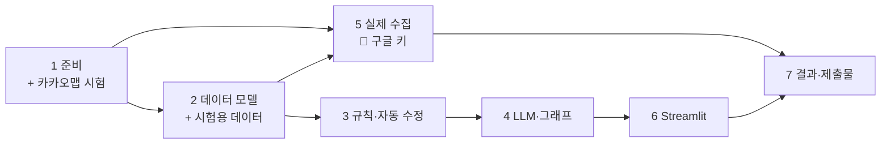

# 서울 여행 계획 HITL 에이전트 — 구현 계획

- 작성일: 2026-11-09
- 기준 설계: [2026-11-09-seoul-trip-hitl-design.md](../specs/2026-11-09-seoul-trip-hitl-design.md) (승인됨)
- 상태: 초안
- 수정 이력: 2026-11-09 교통 API를 ODsay(무료 하루 30건)에서 카카오 대중교통 경로(무료 하루 1,000건)로 변경, 과금 방지 작업 추가

---

## 0. 이 계획에서 새로 정한 것

설계 문서 6장에서 "구현하는 사람에게 맡기는 것"으로 남긴 항목을 여기서 정한다.

### 0.1 그래프를 두 개로 나눈다 (여행 그래프 + 하루 그래프)
- **여행 그래프** (스레드 1개 = 여행 1건): 입력 → 장소 후보 찾기 → 날짜별로 장소 나누기(LLM) → 날마다 하루 그래프 스레드를 만들어 실행.
- **하루 그래프** (스레드 1개 = 하루, `thread_id = trip-{id}-day-{n}`): 동선 짜기 → 규칙 검사 → 자동 수정 → 판정 → 확정 또는 `interrupt`.
- 이렇게 나누는 이유:
  - 대기 목록의 한 줄이 곧 멈춘 스레드 하나가 된다. 체크포인터에서 멈춘 스레드를 읽기만 하면 대기 목록이 만들어진다.
  - 2일차를 승인하든 반려하든 3일차 스레드에는 영향이 없다. 한 그래프 안에서 여러 날을 동시에 멈추면, 일부만 재개할 때의 동작이 복잡해진다.
  - 반려 후 "그 날만 다시 짜기"가 자연스럽다.

### 0.2 시각은 코드가 계산한다
- LLM은 **방문 순서, 체류 시간, 끼니 자리에 넣을 음식점**만 정한다.
- 도착·출발 시각은 코드가 계산한다. 숙소 출발 시각 + 구간 이동 시간 + 체류 시간을 더한다.
- 이유: 규칙 검사(영업시간 안인지, 막차 이후인지)가 LLM이 적은 시각이 아니라 계산된 시각을 보게 되어 결과가 정확하고, 실행할 때마다 같아진다.

### 0.3 재현성
- LLM은 `temperature=0`으로 호출하고, 응답을 **캐시 파일**(`cache/llm/`, 프롬프트 해시를 키로 사용)에 저장한다. REPORT의 시나리오는 캐시로 다시 돌리면 똑같이 나온다. 캐시는 저장소에 올린다.
- "오늘"(경과일 계산 기준일)은 `config.REFERENCE_DATE`로 고정한다. 기본값은 스냅샷을 수집한 날짜다.

### 0.4 문제를 두 종류로 나누는 표 (5.2 구체화)

| 검사 결과 | 종류 | 처리 |
|---|---|---|
| 휴관일·정기 휴무일에 방문 (영업시간 정보가 있고 최근 확인됨) | 확실히 틀림 | 다른 날로 옮기거나, 같은 날 순서를 바꾼다 |
| 방문 시각이 영업시간 밖 (정보가 있고 최근 확인됨) | 확실히 틀림 | 순서를 바꾸거나 체류 시간을 줄인다 |
| 음식점 폐업 확정 (`CLOSED_PERMANENTLY`, 최근 확인됨) | 확실히 틀림 | 같은 끼니 자리의 대체 음식점으로 바꾼다 |
| 스냅샷에 없는 구간 (추정값) | 확실히 고칠 수 있으면 고침 | 정보가 있는 구간을 쓰도록 순서를 바꾼다 |
| 기준 1~4에 걸림 (정보 없음, 낡음, 대안 없음, 특별 운영일 등) | 불확실 | 멈춘다 |
| 위의 "확실히 틀림"인데 대안이 없거나 수정 횟수 상한을 넘음 | 불확실 | 멈춘다 |

- 자동 수정 횟수 상한: **3회**.
- 3단계 구현 중 정한 세부 규칙:
  - 추천 경로가 **도보**인 구간은 기준 1·4를 검사하지 않는다. 걷는 길은 노선처럼 없어지거나 바뀌지 않는다.
  - **막차 시각을 모르는 구간**은 "막차 이후"로 보지 않는다. 카카오 경로 API가 막차를 주지 않아서, 모르면 멈추게 하면 거의 모든 날이 멈춘다(실패 조건).
  - 정보가 **오래된(30일 초과)** 장소는 휴무일·영업시간 밖이어도 "확실히 틀림"으로 고치지 않고 기준 4로 사람에게 묻는다.
  - 관광지는 일정에서 **빼지 않는다**. 같은 날 순서 바꾸기나 다른 날로 옮기기(`fix_allocation`)로 못 고치면 사람에게 넘긴다.
  - 음식점 대체 후보는 "그 자리에서 문제 없음 + 하루 전체의 확실한 오류가 늘지 않음"을 만족해야 하고, 그중 오류가 가장 적고 가까운 곳을 고른다.
- 멈출 때는 걸린 기준마다 `{기준 번호, 장소/구간, 걸린 값, 기준값}`을 남긴다. 예: `{2, "○○식당", "최근 리뷰 152일 전", "90일"}`. 상세 화면에는 이 값을 문장으로 바꿔 보여 준다.

### 0.5 입력 방식 (데모)
- 가고 싶은 장소: 스냅샷에 있는 관광지에서 여러 개 고른다(multiselect).
- 숙소 위치: 미리 정한 3~4곳(예: 명동, 홍대입구, 강남역, 종로) 중에서 고른다. 숙소에서 각 장소까지의 구간을 미리 수집해 두기 위해서다.
- 날짜: 시작일과 종료일. 최대 4일.
- 음식점은 사람이 고르지 않는다. 후보 찾기 단계에서 동선 근처의 음식점을 후보로 주고, LLM이 끼니(점심·저녁)마다 하나씩 고른다.

### 0.6 수집 범위 (API 호출 수 줄이기)
- 장소 40~50곳: 관광지 약 25곳 + 음식점 약 20곳, 4~5개 권역(경복궁·북촌, 명동·남산, 홍대·연남, 성수, 잠실 등)에 고르게.
- 구간: 모든 장소 쌍(약 2,000개)이 아니라 **각 장소에서 가까운 8곳 + 숙소 후보에서 모든 장소까지**만 수집한다. 약 350구간으로, 카카오 대중교통 경로 무료 한도(하루 1,000건) 안에서 하루에 끝난다.
- 스냅샷에 없는 구간은 직선거리로 시간을 추정하고 `source: "추정"`으로 표시한다. 자동 수정에서 먼저 이 구간을 피하도록 순서를 바꾼다. 그래도 남으면 기준 1의 "대안 정보 없음"으로 멈춘다.

### 0.7 폴더 구조

```
seoul-trip-hitl/
├─ app.py                  # Streamlit 진입점
├─ config.py               # 모델명, 기준값(90일·30일), 상한, REFERENCE_DATE, 경로
├─ trip/
│  ├─ models.py            # Place, Segment, DayPlan, Stop, Issue 등 (pydantic)
│  ├─ state.py             # TripState, DayState
│  ├─ provider.py          # DataProvider 인터페이스, SnapshotProvider, LiveProvider
│  ├─ live_google.py       # 구글 Places 조회
│  ├─ live_kakao.py        # 카카오 대중교통 경로·노선·경로 좌표 조회
│  ├─ candidates.py        # 장소 후보 찾기
│  ├─ planner.py           # LLM 호출 (날짜별 배분, 하루 동선, 반려 후 다시 짜기) + 캐시
│  ├─ prompts.py
│  ├─ schedule.py          # 시각 계산
│  ├─ rules.py             # 기준 1~4 + "확실히 틀림" 검사 (순수 함수)
│  ├─ fixer.py             # 자동 수정
│  ├─ graphs.py            # 여행 그래프, 하루 그래프, SqliteSaver
│  ├─ service.py           # 그래프 실행, 여행 목록, 대기 목록, 재개 (계획의 store.py)
│  └─ maps.py              # 카카오맵 HTML / folium 대체 지도
├─ data/
│  ├─ snapshot/places.json, segments.json, lodgings.json
│  ├─ overrides.json       # 기준 시연용 수정 목록 (원래 값 포함)
│  └─ app.sqlite           # 체크포인터 (gitignore)
├─ cache/llm/              # LLM 응답 캐시 (저장소에 올림)
├─ scenarios/              # REPORT용 고정 입력
├─ scripts/
│  ├─ collect.py           # 스냅샷 수집
│  └─ run_scenarios.py     # 시나리오 일괄 실행 → results/
├─ results/                # 실행 결과 표
├─ screenshots/
├─ tests/
├─ requirements.txt, .env.example, .gitignore
└─ README.md, REPORT.md
```

---

## 1. 단계별 작업

각 작업의 "완료 기준"을 만족해야 다음으로 넘어간다. 🔑 표시는 **사용자가 직접 해야 하는 일**이다.

### 1단계. 프로젝트 준비
| # | 작업 | 완료 기준 |
|---|---|---|
| 1.1 | `git init`, `.gitignore`(`.env`, `.venv/`, `data/app.sqlite`, `__pycache__/`, `.DS_Store`), `.env.example` | `.env`가 `git status`에 나오지 않는다 |
| 1.2 | uv로 `.venv` 만들기, `requirements.txt` (`langgraph==1.2.19`, `langchain-openai==1.7.3`, `streamlit==1.66.1`, `langgraph-checkpoint-sqlite`, `pydantic`, `python-dotenv`, `folium`, `streamlit-folium`, `httpx`, `pytest`) | 설치 후 `import` 확인. 버전이 맞지 않는 패키지가 있으면 맞는 버전으로 고정하고 기록 |
| 1.3 | `config.py`: 모델명(`gpt-5.6-terra`, 환경 변수로 변경 가능), 기준값, 수정 상한, `REFERENCE_DATE` | — |
| 1.4 | 🔑 키 발급: 카카오 앱의 JavaScript 키와 REST API 키(Web 플랫폼에 `http://localhost:8501` 등록, 카카오맵 사용 설정. **이미 카카오맵을 켠 앱이 있으면 그 앱을 쓴다**), OpenAI 키를 `.env`에 넣기 | `.env`에 세 키가 있음 |
| 1.5 | **카카오맵 확인용 시험**: Streamlit의 `components.html`로 카카오맵 하나 띄우기, 마커 2개와 선 1개 그리기 | 브라우저에서 지도가 뜬다. 안 뜨면 원인 기록 후 커스텀 컴포넌트 방식 시험, 그래도 안 되면 folium을 기본으로 바꾸고 사용자에게 알림 |

> 1.5를 먼저 하는 이유: 설계 문서 5.6에서 "먼저 확인할 위험"으로 꼽았고, 결과에 따라 6단계 지도 작업이 달라진다.

### 2단계. 데이터 모델과 시험용 데이터
| # | 작업 | 완료 기준 |
|---|---|---|
| 2.1 | `models.py`: `Place`(id, 이름, 종류, 좌표, 권역, 영업 상태, 요일별 영업시간, 특별 운영일, 평점, 리뷰 수, 최근 리뷰 날짜, 마지막 확인일, 출처, 수정됨/원래 값), `Segment`(출발, 도착, 이동 수단 목록, 소요 시간, 노선, 막차 시각, 경로 좌표, 마지막 확인일, 출처) | — |
| 2.2 | `DataProvider` 인터페이스: `places()`, `place(id)`, `segment(from, to)`, `lodgings()` | — |
| 2.3 | `SnapshotProvider`: 스냅샷 JSON 읽기 + `overrides.json` 적용 + 없는 구간은 추정값으로 반환 | 테스트: 덮어쓰기가 적용되고 원래 값이 남는다, 없는 구간은 `source="추정"` |
| 2.4 | **손으로 만든 작은 시험용 데이터** (`tests/fixtures/`, 장소 10곳, 구간 20개). 기준 1~4에 걸리는 사례를 하나씩 포함 | 실제 수집(5단계) 전에 3~4단계를 개발·테스트할 수 있다 |

### 3단계. 규칙 검사와 자동 수정 (LLM 없음, 전부 테스트)
| # | 작업 | 완료 기준 |
|---|---|---|
| 3.1 | `schedule.py`: 순서 + 체류 시간 → 도착·출발 시각 계산 | 테스트: 구간 시간이 정확히 더해진다 |
| 3.2 | `rules.py` 기준 1: 구간의 이동 수단이 1개뿐이거나 추정 구간이거나, 계획 시각이 막차 이후 | 걸리는 경우·안 걸리는 경우 테스트 |
| 3.3 | 기준 2: 음식점이 영업 중이 아님, 최근 리뷰 > 90일, 그 날짜의 영업시간 없음 | 경계값(90일, 91일) 테스트 |
| 3.4 | 기준 3: 관광지 방문 시각의 운영 정보 없음, 특별 운영일·임시 휴관 표시 | 테스트 |
| 3.5 | 기준 4: 장소·구간의 마지막 확인일 > 30일 (`REFERENCE_DATE` 기준) | 경계값 테스트 |
| 3.6 | "확실히 틀림" 검사: 휴관일 방문, 영업시간 밖, 폐업 확정 | 테스트 |
| 3.7 | `fixer.py`: 0.4 표대로 수정. 수정할 때마다 "무엇을 왜 바꿨는지" 기록 | 테스트: 휴관일 방문이 다른 날로 옮겨진다, 폐업 식당이 대체된다, 대안이 없으면 불확실로 넘어간다, 3회 넘으면 멈춤 |
| 3.8 | 판정 함수: 문제 목록 → `자동 확정` 또는 `멈춤 + 이유 목록` | 이유가 `{기준, 대상, 값, 기준값}` 형태로 나온다 |

### 4단계. LLM과 그래프
| # | 작업 | 완료 기준 |
|---|---|---|
| 4.1 | `planner.py`: 구조화 출력(pydantic)으로 ① 날짜별 장소 배분 ② 하루 동선(순서, 체류 시간, 끼니 음식점, 각 장소를 고른 이유) ③ 반려 사유를 반영해 다시 짜기. 프롬프트 해시로 캐시 | 같은 입력을 두 번 넣으면 두 번째는 캐시에서 나온다 |
| 4.2 | `candidates.py`: 고른 관광지 + 그 근처 음식점(영업 중, 평점 순) 후보 | 테스트 |
| 4.3 | `state.py`: `TripState`(입력, 후보, 날짜별 배분, 하루 스레드 id 목록), `DayState`(날짜, 동선, 계산된 시각, 문제 목록, 수정 기록, 수정 횟수, 판정, 멈춘 이유, 사람 결정, 반려 사유, 반려 횟수) | — |
| 4.4 | 하루 그래프: `plan_day → check → (fix → check)* → judge → confirm` / `judge → review(interrupt) → confirm 또는 replan → check` | — |
| 4.5 | 여행 그래프: `intake → candidates → allocate → spawn_days`(하루 스레드를 차례로 실행) | — |
| 4.6 | `SqliteSaver`(`data/app.sqlite`) 연결. `store.py`: 여행 목록, 멈춘 스레드 목록(`get_state().interrupts`), 확정 계획 조회 | — |
| 4.7 | 그래프 테스트 (LLM은 고정 응답을 주는 가짜로 대체): 문제없는 날은 자동 확정, 문제 있는 날만 멈춤, 승인하면 확정, 반려하면 다시 짜서 재검사 | 테스트 통과 |
| 4.8 | **재시작 테스트**: 멈춘 상태에서 프로세스를 끝내고 새 프로세스에서 같은 `thread_id`로 `Command(resume=...)` | 멈춘 지점부터 이어서 확정된다 |

> **4단계 구현 메모 (2026-11-09)**
> - `store.py` 대신 `service.py`(`TripService`)로 만들었다. 여행 목록은 체크포인터와 같은 SQLite 파일의 `trips` 표에 둔다.
> - 하루 스레드는 차례로 실행하고, **앞선 날에 넣은 음식점은 다음 날 후보에서 뺀다**(실제 모델이 이틀 모두 같은 식당을 고른 것을 보고 추가).
> - 자동 수정으로 순서가 바뀐 장소는 LLM이 적은 이유 뒤에 "(자동 수정으로 순서가 바뀜)"을 붙인다(이유와 실제 순서가 어긋나 보이는 문제).
> - 실제 모델(`gpt-5.6-terra`)로 시험용 데이터 여행 1건을 돌려 확인: 배분·하루 동선·반려 후 재작성 모두 구조화 출력으로 정상 동작, 호출당 약 7초.
> - 시험용 데이터는 문제 사례가 몰려 있어 이틀 모두 멈췄다. 멈춘 날 비율은 실제 스냅샷으로 7단계에서 확인한다.

### 5단계. 실제 데이터 수집 (2~4단계와 동시에 진행 가능)
| # | 작업 | 완료 기준 |
|---|---|---|
| 5.1 | 🔑 키 발급: 구글 클라우드 결제 계정 + Places API (New) 키. **Cloud 콘솔에서 Places API 하루 요청 상한을 낮게(예: 200건) 걸어 과금을 막는다** | `.env`에 키가 있고 상한이 설정됨 |
| 5.2 | 수집할 장소 목록 확정 (0.6 기준, 이름 + 권역) | 사용자 확인 |
| 5.3 | `live_google.py`: Text Search로 장소 찾기 → Place Details로 `businessStatus`, `regularOpeningHours`, `currentOpeningHours`(특별 운영일), `rating`, `userRatingCount`, `reviews`(최근 리뷰 날짜만 사용) | 장소 3곳으로 시험 조회 성공 |
| 5.4 | `live_kakao.py`: 카카오 대중교통 경로 조회(대안 경로 개수, 소요 시간, 노선) + 경로 좌표 + 막차 시각. **먼저 공식 문서와 구간 3개 시험 조회로 응답에 무엇이 들어 있는지 확인**한다. 막차가 없으면 `null`로 저장(필요하면 공공데이터 버스 API로 보완), 경로 좌표가 없으면 지도는 직선으로 그린다 | 구간 3개로 시험 조회 성공, 얻을 수 있는 필드와 막차 처리 방식 기록 |
| 5.5 | `scripts/collect.py`: 장소 → 구간 순서로 수집, 중간에 끊겨도 이어서 수집, 호출 간격 두기 | 스냅샷 파일 생성. 수집 날짜 기록 |
| 5.6 | `overrides.json`: 기준 1~4를 하나 이상씩 시연할 수정 사례 6~8개 (원래 값, 바꾼 값, 이유) | — |
| 5.7 | `LiveProvider`: 같은 인터페이스로 실시간 조회 (키가 있을 때만) | 장소 하나로 시험 |

> **5.4 사전 확인 결과 (2026-11-09, 경복궁→성수역 1건 조회):** `GET https://dapi.kakao.com/v2/routing/publictraffic`
> - 있음: 대안 경로 개수(`properties.total`, 버스/지하철/버스+지하철별 개수), 경로별 총 소요 시간·거리·환승 횟수·요금, 구간별 노선 이름과 종류(`vehicles[].name`, 예: `N62(심야)`), 정류장 이름, **경로 좌표**(`steps[].path.points`, `[경도, 위도]` 순서)
> - 없음: **첫차·막차 시각**, 출발 시각 지정 파라미터
> - 따라서 기준 1의 "막차 이후"는 카카오만으로 판단할 수 없다. 버스 구간은 공공데이터포털 서울 버스 노선 정보 API(노선별 첫차·막차, 무료 키)로 보완하거나, `null`로 두고 시연용 수정 사례로 보여 준다. 정하는 것은 5.4에서.
> - 응답 샘플은 저장소에 올리지 않았다(키 노출 없음, 필요하면 다시 조회).

> 키 발급이 늦어지면 2.4의 시험용 데이터로 6~7단계까지 먼저 진행하고, 수집이 끝나면 스냅샷만 바꾼다.

### 6단계. Streamlit 데모
| # | 작업 | 완료 기준 |
|---|---|---|
| 6.1 | 입력 화면: 날짜, 가고 싶은 장소(multiselect), 숙소 → 실행 → 결과 요약(자동 확정 N일, 대기 M일) | — |
| 6.2 | 대기 목록: 여행, 날짜, 멈춘 이유 요약 | 앱을 다시 켜도 목록이 남아 있다 |
| 6.3 | 상세 화면: 요청 원문, 동선과 장소별 선택 이유, 자동 수정 기록, 멈춘 이유(구체적인 값), "승인하면 이 경로가 지도에 확정됨", 승인 / 반려(사유 입력) | 승인·반려 후 상태가 바로 바뀐다 |
| 6.4 | `maps.py`: 지점·경로 좌표·정보창 내용을 하나의 지도 데이터로 만들고, 카카오맵(키 있음) 또는 folium(키 없음)으로 그린다. 기준에 걸린 지점은 다른 색·⚠ 표시 | 키를 빼고 실행해도 지도가 나온다 |
| 6.5 | 확정된 여행 화면: 날짜별 확정 경로 지도 | — |

### 7단계. 실행 결과와 제출물
| # | 작업 | 완료 기준 |
|---|---|---|
| 7.1 | `scenarios/`: 고정 입력 3~4건 (총 9~12일). 문제없는 여행 1건, 문제 있는 날이 섞인 여행 2~3건 | — |
| 7.2 | `run_scenarios.py`: 실행 → `results/`에 날짜별 판정, 자동 수정 기록, 멈춘 이유 표 | 두 번 실행해도 결과가 같다 |
| 7.3 | **실패 조건 점검**: 멈춘 날 비율(목표: 전체의 20~50%), 휴관일 방문이 자동 수정되었는지, 멈춘 이유가 모두 구체적인 값인지. 벗어나면 기준값을 조정하고 이유 기록 | 설계 문서 2장 "실패로 볼 것" 5개 모두 해당 없음 |
| 7.4 | 데모에서 대기 건을 사람이 처리 (승인 1건 이상, 반려 후 재검토 1건 이상) + 화면 캡처 | `screenshots/` |
| 7.5 | README.md (설치, 실행, 스냅샷으로 실행, 카카오 키 발급·도메인 등록, 데이터 다시 수집) | 새 폴더에 복제해서 README대로 실행하면 돌아간다 |
| 7.6 | REPORT.md (설계 문서 5.7 항목 + 데이터 출처와 수정 항목 + 회고) | — |
| 7.7 | 저장소에 키가 없는지 확인 (`git log -p`에서 키 패턴 검색) | 키 없음 |
| 7.8 | 🔑 GitHub 저장소 만들고 올리기 (올리기 전에 사용자 확인) | — |

---

## 2. 순서와 동시 진행



- 5단계(실제 수집)는 키만 있으면 3~4단계와 동시에 진행할 수 있다. 키 발급이 가장 오래 걸릴 수 있으므로 미리 해 두면 좋다.

## 3. 위험과 대비

| 위험 | 대비 |
|---|---|
| Streamlit iframe에서 카카오맵이 안 뜸 | 1.5에서 먼저 확인. 커스텀 컴포넌트 → folium 순으로 대체 |
| 카카오 경로 응답에 막차 시각이나 경로 좌표가 없음 | 막차를 `null`로 저장하고, 기준 1은 "대안 없음"만으로 판단. 막차 사례는 `overrides.json`으로 시연하고 REPORT에 밝힘 |
| 구글 리뷰 필드가 비싼 등급이라 무료 한도(월 1,000건)를 넘김 | 장소 50곳 × 1회 수집이라 한도 안. Cloud 콘솔 하루 요청 상한으로 과금 자체를 막음. 실시간 조회에서는 리뷰 필드를 빼는 옵션 |
| 카카오 무료 한도를 다른 앱이 이미 쓰고 있음 (계정당 첫 활성화 앱만 무료) | 기존 앱을 재사용. 유료 설정을 켜지 않으면 한도 초과 시 429 오류만 나고 과금은 없음 |
| LLM이 시나리오마다 결과가 달라짐 | 캐시 + `temperature=0` + 시각은 코드 계산 |
| 모든 날이 멈춤 | 7.3에서 비율 확인. 원인 기준을 찾아 기준값을 조정하거나 자동 수정 범위를 넓힘 |
| `gpt-5.6-terra`가 비용·속도 면에서 부담 | 캐시로 반복 호출을 없애고, 필요하면 배분 단계만 `gpt-5.6-luna`로 바꿈 |
