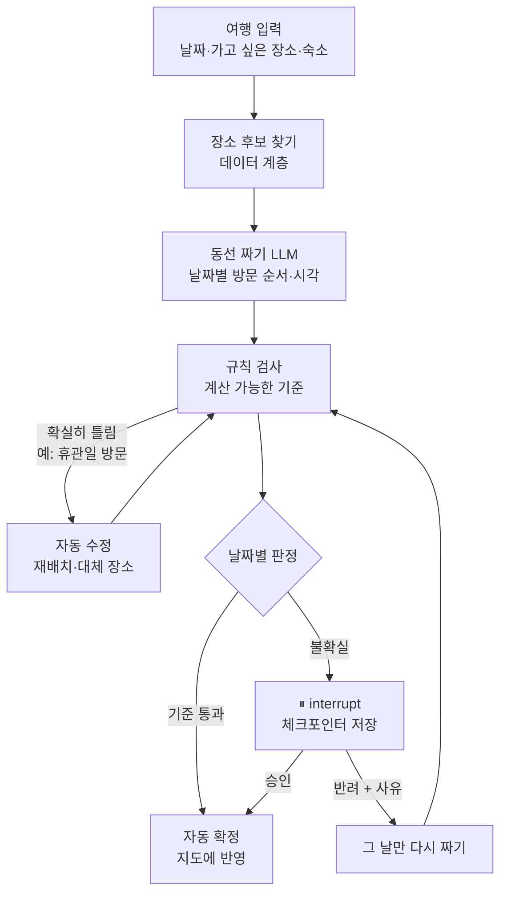

# 서울 여행 계획 HITL 에이전트 — 설계 문서

- 작성일: 2026-11-09
- 상태: **승인됨 (2026-11-09)**. 검토자 확인(builder check)은 하지 않았음
- 수정 이력: 2026-11-09 데이터 방법을 "실제 API로 한 번 수집 후 스냅샷 저장"으로 확정, 지도에 실제 경로 좌표 사용 (4장, 5.4, 5.6, 5.7, 6장) / 같은 날 지도를 카카오맵으로 확정, 키가 없으면 OpenStreetMap으로 대체 (2장, 5.4, 5.6, 5.7) / 같은 날 교통 API를 ODsay에서 카카오 대중교통 경로로 변경, API 비용 표 추가 (2장, 4장, 5.4, 6장)
- 과제: 아이펠 「에이전트 팀 꾸리기_Agt2」 5. 프로젝트 — 사람이 승인하는 에이전트 만들기

---

## 1. 의도와 이유

### 최종 목표 (이번 범위 아님, 방향을 잡기 위한 배경)
여행자가 가고 싶은 장소, 나라, 일정을 넣으면 에이전트가 동선, 주요 관광지, 맛집까지 짜 주는 여행 앱.
- 앱 안의 지도에 경로가 자동으로 그려지고, 여행자는 이 지도를 보며 실제로 움직인다.
- 경로 위 지점을 누르면 종류에 따라 정보가 나온다. 음식점은 구글 평점과 리뷰, 버스정류장은 버스 시간표, 관광지는 주요 볼거리.
- 장기적으로는 사용자끼리 코스를 추천하고 맛집 평점을 남기는 커뮤니티로 키운다.
- 지역은 전 세계가 목표지만, 국내 → 서울 순으로 좁혀서 시작한다.

### 이번 과제에서 만드는 것
최종 앱의 핵심 엔진인 **"계획을 짜고 → 검사하고 → 불확실한 날만 사람이 확인하는" 파이프라인의 MVP**.

### 결과가 바깥으로 나가는 순간
**계획이 지도에 확정되어 여행자에게 넘어가는 순간.** 여행자는 확정된 계획을 그대로 믿고 움직이기 때문에, 이 순간이 잘못된 정보가 현실의 피해(헛걸음, 이동 수단 없음)로 이어지는 지점이다.
- 승인하는 사람은 여행자 본인이다.
- 나중에 커뮤니티를 만들면 "사용자 코스를 공개하기 전 검수"에 같은 멈춤·승인 구조를 다시 쓸 수 있다.

### 사용자가 꼽은 실제 위험 (승인 기준의 출발점)
1. 추천 코스대로 갔는데 교통편이 바뀌었고 정보가 업데이트되지 않아, 그 지역으로 가는 버스가 없어졌다.
2. 음식점에 갔는데 문이 닫혀 있거나 없어졌다.
3. 운영시간이 자주 바뀌는 관광지는 운영시간을 고려해 동선을 짜야 한다.

→ 세 가지 모두 **"에이전트가 가진 정보가 지금 현실과 맞지 않을 위험"**이다.

---

## 2. 목표 / 하지 않을 것 / 실패로 볼 것

### 목표
- 서울 여행 입력(날짜, 가고 싶은 장소, 숙소 위치)을 받아 날짜별 동선을 만든다.
- 확실히 틀린 부분은 에이전트가 스스로 고친다. 정보가 불확실한 날만 멈춰서 사람에게 묻는다.
- 기준에 걸리지 않은 날은 사람을 거치지 않고 끝까지 자동으로 확정한다.
- 대기 중인 건은 체크포인터에 저장해서, 나중에 확인해도 멈춘 지점부터 이어서 처리한다.
- Streamlit 데모에서 대기 목록 확인, 상세 확인, 승인·반려, 지도 확인을 할 수 있다.
- 장소·교통 데이터는 실제 API(구글 Places, 카카오 대중교통 경로)로 수집한 진짜 데이터를 쓰고, 지도는 카카오맵 위에 실제 경로를 그린다(키가 없으면 OpenStreetMap으로 대체).

### 하지 않을 것 (이번 범위 밖)
- 커뮤니티(코스 추천, 평점·리뷰 작성), 회원 기능
- 전국·해외 확장
- 실시간 버스 시간표 팝업 (이번에는 구간 이동 정보만 표시)
- 실제 예약이나 결제
- 공개 배포 (로컬 실행이 필수 범위. 배포하더라도 API 키는 저장소에 올리지 않음)

### 실패로 볼 것 (돌아가더라도 실패)
- 모든 날이 멈춘다. 승인이 형식적인 절차가 되어 HITL의 의미가 없다.
- 확실히 틀린 일정(예: 휴관일 방문)을 자동으로 고치지 않고 사람에게 떠넘긴다.
- 멈춘 이유가 "확인 필요"처럼 막연해서 사람이 무엇을 보고 판단해야 할지 모른다.
- 실행할 때마다 결과가 달라서 REPORT의 실행 결과를 재현할 수 없다.
- API 키가 저장소에 올라간다.

---

## 3. 제약

- 과제 필수 구현 3가지: (1) HITL 파이프라인(멈춤 → 사람 답 → 그 지점부터 재개, 기준 미해당 건은 자동 처리, 체크포인터 저장), (2) 계산 가능한 승인 기준 2개 이상과 그 이유, (3) Streamlit 또는 Gradio 웹 데모
- 실습에서 다룬 **환불 승인은 주제로 쓸 수 없음** (이 주제는 해당 없음)
- 프레임워크: 실습에서 쓴 구조 (LangGraph의 interrupt와 체크포인터)
- LLM: **실습에서 쓰던 것과 같은 모델과 제공사** → OpenAI (`langchain-openai`, 키는 `OPENAI_API_KEY`)
  - 실습 모델 등급: `gpt-5.6-luna`(비용 최적화), `gpt-5.6-terra`(성능과 비용의 균형), `gpt-5.6-sol`(복잡한 작업)
  - 동선 짜기는 지켜야 할 조건(영업시간, 이동 시간, 숙소 위치)이 많으므로 `gpt-5.6-terra`로 시작한다. 모델명은 환경 변수로 바꿀 수 있게 한다.
  - 버전 기준: `langgraph==1.2.19`, `langchain-openai==1.7.3`, `streamlit==1.66.1` (이전 과제 `my-routing-agent`의 requirements와 맞춤)
  - 확인한 출처: 수업 자료 `D03_고객응대_노드_완전판.html`, `costomor_igent/modumall-agent/config.py`, `my-routing-agent/requirements.txt`. 환불 승인 실습 코드 자체는 로컬에 없었다.
- 지역: 서울
- 제출물: 깃허브 저장소(실행 파일, README.md, REPORT.md)

---

## 4. 검토한 방법 (Approaches)

뼈대(입력 → 후보 → 동선 생성 → 규칙 검사 → 자동 수정 → 날짜별 판정 → 멈춤/확정)는 세 방법이 같고, **장소·교통 데이터를 어디서 가져오느냐**가 다르다.

| 방법 | 내용 | 장점 | 단점 |
|---|---|---|---|
| A. 실시간 API | 구글 Places(영업 상태, 영업시간, 평점, 리뷰)와 국내 대중교통 API(예: 카카오 대중교통 경로, ODsay)를 실시간 조회 | 최종 앱과 가장 가깝다 | 키와 결제 카드 등록이 필요하고, 결과가 매번 달라 재현하기 어렵다 |
| B. 미리 모은 데이터만 사용 | 서울 장소 40~50곳의 정보를 파일로 저장하고, 문제 있는 곳을 일부러 섞는다 | 무료이고 결과가 항상 같다 | 실제 최신 정보가 아니라 "낡은 정보" 위험을 흉내만 낸다 |
| **C. 실제 API로 한 번 모아 저장 (선택)** | 구글 Places와 카카오 대중교통 경로 API를 **한 번만 실제로 조회**해 서울 장소·구간 데이터를 파일(스냅샷)로 저장한다. 기준을 시연할 사례 몇 개는 값을 일부러 바꾸고 바꿨다고 표시한다. 기본 실행은 스냅샷으로 하고, 키가 있으면 실시간 조회로 바꿀 수 있다. 각 항목에 마지막 확인 날짜를 기록한다 | 데이터 자체는 진짜이고, 결과가 항상 같다. 키가 없어도 돌아간다. 앱으로 넘어갈 때 실시간 쪽만 키우면 된다. 마지막 확인 날짜를 그대로 승인 기준으로 쓸 수 있다 | 수집 스크립트와 데이터 계층을 하나 더 만들어야 한다. 수집할 때는 키(구글은 결제 계정 등록)가 필요하다 |

**C를 고른 이유:** 제출물은 누가 실행해도 똑같이 돌아가야 하고(A는 재현이 안 되고, 멈추는 사례가 생길지 우연에 맡겨진다), 데이터는 실제여야 하며(B의 한계), 최종 앱 쪽으로 이어지는 길도 막히지 않아야 한다.

> 참고: **지도 화면**(배경 지도, 경로 선, 마커)은 어느 방법을 골라도 실제 지도를 쓴다. 위 표의 차이는 장소·교통 **데이터**를 어디서 가져오느냐다.

---

## 5. 정해진 설계

### 5.1 파이프라인



- 자동 수정을 무한히 반복하지 않도록 횟수 상한을 둔다(값은 구현할 때 정함). 상한을 넘기면 그 날은 멈춤으로 보낸다.
- 멈추는 단위는 **하루(day)**다. 한 여행에서 문제없는 날은 자동 확정하고, 문제 있는 날만 대기 목록에 오른다.

### 5.2 두 종류의 문제를 나눈다
- **확실히 틀린 것 → 에이전트가 스스로 고친다.** 예: 휴관일 방문, 방문 시각이 영업시간 밖이라는 정보가 확실한 경우.
- **불확실한 것 → 사람에게 묻는다.** 정보가 없거나, 낡았거나, 대안이 없어서 에이전트가 판단할 수 없는 경우.

### 5.3 승인 기준 (계산 가능한 형태)

| # | 대비하는 위험 | 멈추는 기준 |
|---|---|---|
| 1 | 버스가 없어지거나 바뀜 | 그 구간을 갈 수단이 하나뿐(대안 없음)이거나, 계획 시각이 해당 노선의 막차 이후인 경우 |
| 2 | 음식점 폐업·휴무 | 장소 상태가 '영업 중'이 아니거나, 최근 3개월 동안 새 리뷰가 없거나, 그 날짜의 영업시간 정보가 없는 경우 |
| 3 | 관광지 운영시간 변동 | 방문 예정 시각의 운영 정보가 없거나, 특별 운영일·임시 휴관 표시가 있는 경우 |
| 4 | 낡은 정보 전반 | 동선에 들어간 장소나 교통 정보의 마지막 확인일이 30일을 넘은 경우 |

- 숫자(3개월, 30일)는 시작값이다. 구현과 실행 결과를 보고 조정할 수 있고, 조정하면 REPORT에 이유를 적는다.
- **자동으로 확정되는 날을 사람이 보지 않아도 되는 이유:** 그 날의 모든 장소가 영업 중으로 확인됐고, 방문 시각이 영업시간 안이며, 모든 이동 구간에 대안 수단이 있고, 정보가 최근에 확인된 것이기 때문이다.

### 5.4 데이터 계층
- 장소와 교통 정보를 가져오는 부분을 하나의 인터페이스로 감싸고, 구현을 두 개 둔다.
  - **스냅샷(기본):** 저장해 둔 서울 데이터 파일을 읽는다. 데모와 제출은 이것으로 실행한다.
  - **실시간(선택):** API 키가 있으면 같은 인터페이스로 구글 Places와 카카오 대중교통 경로 API를 바로 조회한다.
- **수집 스크립트:** 실시간 구현을 이용해 스냅샷 파일을 만든다. 한 번 실행해서 저장하고, 결과 파일을 저장소에 넣는다.
  - 장소(40~50곳): 좌표, 종류, 영업 상태, 날짜별 영업시간, 특별 운영일, 평점, 최근 리뷰 날짜
  - 구간: 이동 수단 목록(대안 개수), 노선, 소요 시간, 막차 시각(얻을 수 있는 범위에서), **실제 경로 좌표**(카카오 경로 응답에 들어 있는 범위에서)
  - 교통 API로 ODsay 대신 카카오를 고른 이유: ODsay 무료(Basic)는 하루 30건뿐이고 대량 이용에 사전 동의가 필요해서 구간 수백 개를 모을 수 없다. 카카오 대중교통 경로 조회는 하루 1,000건 무료이고, 지도와 같은 카카오 앱 하나로 쓸 수 있다(2026-11-09 확인).
- **기준 시연용 수정:** 실제 데이터만으로는 기준에 걸리는 사례가 생긴다는 보장이 없으므로, 일부 항목의 값을 일부러 바꾼다(폐업 의심 식당, 대안 없는 구간, 막차가 이른 구간, 오래된 확인일, 특별 운영일 관광지 등).
  - 바꾼 항목에는 `수정됨` 표시와 원래 값을 함께 남기고, REPORT에 어떤 항목을 왜 바꿨는지 적는다.
  - 바꾼 값은 원본 수집 결과와 별도 파일(덮어쓰기 목록)로 관리해서, 수집을 다시 해도 같은 수정이 적용되게 한다.
- 모든 항목에 `마지막 확인일`을 둔다. 스냅샷은 수집한 날짜가 들어가고, 실시간은 조회한 시각이 들어간다.
- 실행 결과가 날짜에 따라 달라지지 않도록, "오늘"(경과일 계산 기준일)을 설정값으로 고정할 수 있게 한다.
- 키는 환경 변수나 `.env`로만 읽고, `.env`는 `.gitignore`에 넣는다. 저장소에는 `.env.example`만 둔다.
  - 쓰는 키: 구글 Places(수집·실시간), 카카오 REST API 키(대중교통 경로·장소 검색), 카카오 JavaScript 키(지도 표시), OpenAI(LLM). 카카오 두 키는 같은 앱에서 나온다.
  - 비용 (2026-11-09 확인):

    | API | 무료 범위 | 넘으면 |
    |---|---|---|
    | 카카오맵 지도(JavaScript) | 하루 300,000건 | 유료 설정을 켜지 않으면 429 오류만 남(과금 없음) |
    | 카카오 대중교통 경로 | 하루 1,000건 | 위와 같음 |
    | 카카오 장소 검색·좌표 변환 | 하루 100,000건 | 위와 같음 |
    | 구글 Places (리뷰 포함 상세) | 월 1,000건, **결제 계정 등록 필수** | 1,000건당 약 $25 → Cloud 콘솔에서 하루 요청 상한을 낮게 걸어 과금을 막는다 |
    | OpenAI | 없음 (유료) | 토큰 단위 과금 → LLM 응답 캐시로 반복 호출을 없앤다 |

  - 카카오 무료 한도는 개발자 계정당 **처음 카카오맵을 활성화한 앱**에만 준다. 이미 활성화한 앱이 있으면 새 앱을 만들지 않고 그 앱에 도메인을 추가한다.
  - 카카오 JavaScript 키는 성격상 브라우저에 노출되므로, 카카오 개발자 설정에서 허용 도메인을 `localhost` 등으로 제한해 둔다. 그래도 저장소에는 올리지 않는다.

### 5.5 체크포인터와 재개
- 대기 중인 건은 프로세스를 다시 시작해도 남아 있어야 한다. 그래서 메모리가 아니라 파일 기반 체크포인터(예: SQLite)를 쓴다.
- 데모 화면에서 대기 건을 열고 답하면 해당 스레드가 멈춘 지점부터 이어서 실행된다.

### 5.6 웹 데모 (Streamlit)
- **입력 화면:** 날짜, 가고 싶은 장소, 숙소 위치를 넣고 실행
- **대기 목록:** 승인을 기다리는 날의 목록 (여행, 날짜, 멈춘 이유 요약)
- **상세 화면** (과제 필수 항목):
  - 요청 원문 (여행 입력)
  - 에이전트의 판단과 근거 (그 날의 동선과 각 장소를 고른 이유)
  - 멈춘 이유 (어느 기준의 어떤 값에 걸렸는지 구체적으로. 예: "○○식당: 최근 리뷰 5개월 전")
  - 승인했을 때 일어나는 일 (이 경로가 지도에 확정됨)
  - 승인 / 반려(사유 입력) 버튼
- **지도:** 실제 지도 위에 경로를 그리고, 지점을 누르면 평점, 영업시간, 마지막 확인일을 보여 준다. 기준에 걸린 지점은 눈에 띄게 표시한다.
  - **배경 지도: 카카오맵** (Kakao Maps JavaScript API). Streamlit 화면 안에 HTML 컴포넌트로 넣고, 마커·경로 선·정보창은 카카오맵 기능으로 그린다.
    - 카카오맵을 고른 이유: 서울 지도가 가장 자세하고(골목, 건물, 지하철 출구), 여행자에게 익숙한 화면이다. 무료 한도가 넉넉하고 결제 카드 등록이 필요 없다.
    - 구글 지도를 고르지 않은 이유: 국내 지도 데이터의 해외 반출 제한 때문에 한국 지역의 구글 지도는 덜 자세하다. 또 folium에 구글 타일 주소를 직접 넣는 방식은 이용 약관에 어긋나고, 공식 방법(Map Tiles API)은 결제 계정과 세션 토큰이 필요하다.
  - **키가 없을 때의 대체 지도:** folium + streamlit-folium, OpenStreetMap 타일(키·비용 없음). 누가 실행해도 데모가 돌아가야 하므로, 카카오 키가 없으면 자동으로 이쪽을 쓴다. 두 지도 모두 같은 지도 데이터(지점, 경로 좌표, 표시할 정보)를 받아 그리게 한다.
  - **경로 선:** 스냅샷에 저장한 실제 경로 좌표로 그린다(대중교통 구간은 실제 노선을 따라감). 경로 좌표가 없는 구간(예: 짧은 도보)은 두 지점을 직선으로 잇는다.
  - **먼저 확인할 위험:** 카카오맵은 등록한 도메인에서만 열린다. Streamlit의 HTML 컴포넌트는 iframe 안에서 그려지므로, 구현 첫 단계에서 `http://localhost:8501`을 등록한 상태로 지도가 실제로 뜨는지 확인한다. 안 뜨면 Streamlit 커스텀 컴포넌트로 바꾸거나 대체 지도로 제출한다.
  - 지도 → 화면 방향의 상호작용(지점을 누르면 Streamlit 쪽 상세가 바뀌는 것)은 이번 범위에 넣지 않는다. 지점 정보는 지도 위 정보창으로 보여 준다.

```
[대기 목록]                      [상세: 2일차]
 ▸ 여행#1 2일차  음식점 정보 낡음   요청: 11/20~22, 경복궁·성수…
   여행#1 3일차  대안 없는 구간      판단: 경복궁 → 북촌 → ○○식당 …
                                   멈춘 이유: ○○식당 최근 리뷰 5개월 전
                                   승인하면: 이 경로가 지도에 확정
                                   [지도]  ●──●──⚠──●
                                   [승인]  [반려: 사유 ____]
```

### 5.7 제출물
- 실행 파일
- 스냅샷 데이터 파일, 기준 시연용 덮어쓰기 목록, 수집 스크립트
- README.md: 설치 방법, 실행 방법, 저장한 데이터로 실행하는 방법(기본), 카카오맵 키 발급과 도메인 등록 방법, 키 설정과 데이터 다시 수집하는 방법(선택)
- REPORT.md:
  - 주제와 고른 이유, 결과가 바깥으로 나가는 단계
  - 파이프라인 구조도 (Mermaid. 노드, State 흐름, 멈춤 지점, 재개 경로)
  - 승인 기준과 이유, 자동으로 처리되는 건의 예
  - 데이터 출처(수집 날짜, 사용한 API)와 기준 시연을 위해 일부러 바꾼 항목 목록
  - 실행 결과 (몇 건을 처리해 몇 건이 멈췄고, 사람이 어떻게 처리했는지)
  - 데모 화면 설계 (보여 주기로 한 것과 뺀 것) + 화면 캡처
  - 회고

---

## 6. 구현하는 사람에게 맡기는 것
- State 필드의 구체적인 구성
- 저장할 서울 데이터의 구체적인 장소 목록과 파일 형식
- 자동 수정 루프의 횟수 상한
- 구글 Places에서 가져올 필드 범위 (리뷰 등 비싼 등급 필드는 무료 한도 안에서)
- 카카오 대중교통 경로 응답에서 얻을 수 있는 것(대안 경로 개수, 노선, 경로 좌표, 막차 시각) 확인. 막차 시각을 얻지 못하면 해당 값은 "정보 없음"으로 저장하고, 필요하면 공공데이터 버스 API로 보완
- 프로젝트 폴더 구조

## 7. 다음 단계
1. 이 문서를 읽고 수정하거나 승인한다.
2. (선택) 검토자 확인(builder check)을 받는다.
3. 승인되면 구현 계획(writing-plans)을 세운다. → [구현 계획](../plans/2026-11-09-seoul-trip-hitl-plan.md) (6장 항목을 여기서 정함)
